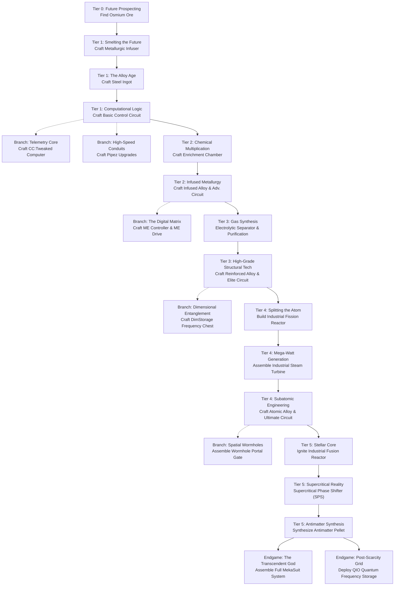

# 🏆 MekPack: Custom Achievement Flow Blueprint

This blueprint outlines the custom progression tree that will guide players from **Tier 0 (Day One)** through **Endgame (Supercritical Phase Shifting & Antimatter)** with rewarding milestones along the way.

---

## 1. Visual & Audio Presentation

- **Tree Interface**: Rendered via `Better Advancements` for a smooth, full-screen, zoomable vector tech tree with customized line color accents matching Mekanism tier hues (Cyan, Red, Blue, Purple).
- **Celebration Banners**: Displayed using `Advancement Plaques` for dynamic, high-tech animated popups accompanied by subtle futuristic chimes.
- **Custom Background**: Dark carbon-fiber / quantum matrix grid backdrop (`mekpack:textures/gui/advancements/background.png`).

---

## 2. Master Progression Tree: 0 to Endgame

---

## 3. Detailed Milestones & Rewards Breakdown

### Tier 0: Ground Zero
- **`mekpack:root` (Welcome to Future Frontiers)**
  - *Task*: Enter the world.
  - *Reward*: MekPack Field Manual + 5x Torches + Canteen.
- **`mekpack:find_osmium` (The Blue Vein)**
  - *Task*: Mine Raw Osmium.
  - *Reward*: 8x Osmium Raw Ore + 50 XP.

### Tier 1: The Spark of Steel
- **`mekpack:craft_metallurgic_infuser` (The Heart of Metallurgy)**
  - *Task*: Craft the Metallurgic Infuser.
  - *Reward*: 16x Coal + 16x Redstone + 8x Enriched Iron.
- **`mekpack:craft_steel` (Tempered Ambition)**
  - *Task*: Smelt your first Steel Ingot.
  - *Reward*: 1x Steel Casing + 100 XP.
- **`mekpack:craft_basic_circuit` (Binary Inception)**
  - *Task*: Fabricate a Basic Control Circuit.
  - *Reward*: 2x Basic Control Circuits + 2x Energy Tablets.

### Tier 2: Kinetic Automation
- **`mekpack:craft_enrichment_chamber` (Molecular Multiplication)**
  - *Task*: Craft an Enrichment Chamber.
  - *Reward*: 4x Speed Upgrades + 4x Energy Upgrades.
- **`mekpack:craft_infused_alloy` (Alloy Dynamics)**
  - *Task*: Synthesize an Infused Alloy.
  - *Reward*: 4x Infused Alloys + 1x Basic Tier Installer.
- **`mekpack:ae2_inception` (Digital Genesis)**
  - *Task*: Craft an ME Controller using your Mekanism Steel Casing.
  - *Reward*: 1x ME Terminal + 2x 4k ME Storage Cells.

### Tier 3: Chemical Mastery
- **`mekpack:gas_infrastructure` (Elemental Partition)**
  - *Task*: Craft an Electrolytic Separator and store Hydrogen/Oxygen.
  - *Reward*: 1x Armored Jetpack + 1x Gas Tank.
- **`mekpack:craft_reinforced_alloy` (Reinforced Kinetics)**
  - *Task*: Synthesize a Reinforced Alloy.
  - *Reward*: 2x Advanced Tier Installers + 250 XP.
- **`mekpack:dim_frequency` (Cross-Planetary Frequency)**
  - *Task*: Bind a Dimensional Chest or Tank.
  - *Reward*: 1x Dim Core + 1x Teleportation Core.

### Tier 4: Nuclear Splendor
- **`mekpack:fission_reactor` (Chain Reaction)**
  - *Task*: Form a multiblock Fission Reactor.
  - *Reward*: Full Hazmat Suit + 16x Radioactive Waste Barrels + 500 XP.
- **`mekpack:industrial_turbine` (Megawatt Cyclone)**
  - *Task*: Assemble an Industrial Steam Turbine.
  - *Reward*: 4x Ultimate Energy Cubes + 4x Elite Tier Installers.
- **`mekpack:craft_atomic_alloy` (Atomic Harmony)**
  - *Task*: Synthesize an Atomic Alloy and Ultimate Control Circuit.
  - *Reward*: 2x Ultimate Tier Installers + 1000 XP.

### Tier 5: The Supercritical Frontier (Endgame)
- **`mekpack:stellar_fusion` (Harnessing the Sun)**
  - *Task*: Ignite a D-T Fusion Reactor with Laser Amplifiers.
  - *Reward*: 1x Quantum Entangloporter + 2000 XP.
- **`mekpack:sps_antimatter` (Beyond the Standard Model)**
  - *Task*: Form a Supercritical Phase Shifter (SPS) and produce 1x Antimatter Pellet.
  - *Reward*: 1x Antimatter Pellet + Creative Flight module base + 5000 XP.
- **`mekpack:mekasuit_god` (Transcendent Cybernetics)**
  - *Task*: Equip full MekaSuit with Laser Dissolution, Locomotion, and Solar Charging units.
  - *Reward*: Title "Cybernetic Sovereign" + Golden Star Trophy.

---

## 4. Implementation Phasing

1. **Phase 1 (Active)**: Establish modpack philosophy, developer guidelines, and the comprehensive recipe integration matrix.
2. **Phase 2 (Next)**: Implement the custom recipe overrides across `pipez`, `ae2`, `computercraft`, `dimstorage`, `entangled`, `wormhole`, `shrink`, `chunkloaders`, `trashcans`, and `movingelevators`.
3. **Phase 3**: Build and register the custom advancement datapack (`data/mekpack/advancement/...`) with Better Advancements and Advancement Plaques visual styling and custom loot tables.
